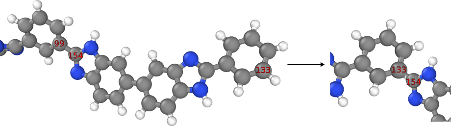

# antechamber

The `go` script builds 10mer files and then produces their prmtop files

```
python ../../polymof/extract_monomer.py --bond 154:99 --attach 133 --polymerize 10 pentamer.pdb 10mer.pdb
```

This instructs the script to define the monomer as being between atoms 154 and 133 (inclusive).  The bond between atoms 154 and 99 is broken and then a new bond formed between 154 and 133 for each repeat unit in the final polymer.  The script shifts the new repeat unit so that the new bond between 133 and new 154 is equal to the original bond vector between 99 and 154.  The process is illustrated below.



The polymerization process is repeated 10 times and then hydrogens attached to the atoms on the ends equivalent to the original 154 and 133 with the original bond vectors.

```
for h in 0467554 0527564 0568015 0619877 0984613 1045277; do
  python ../../polymof/flip_hydrogens.py 10mer.pdb 10mer${h}.pdb $h
done
```

This loops over six tautomers and flips the hydrogens between nitrogens.  Each bit in the number corresponds to one hydrogen; 0 indicates H is closer to the bridge between benzenes, 1 indicates H is farther away.
